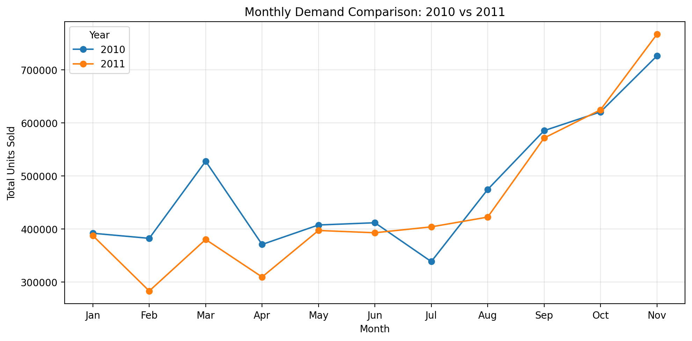
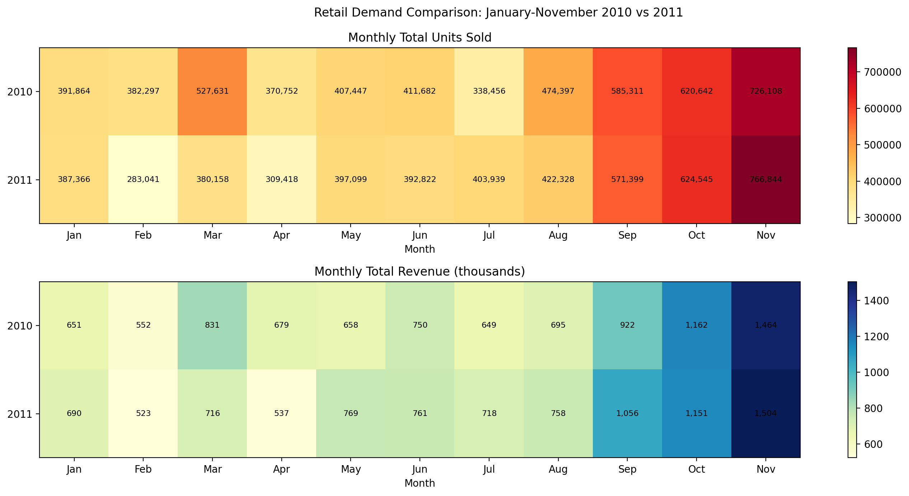
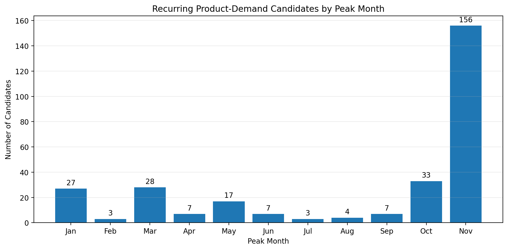
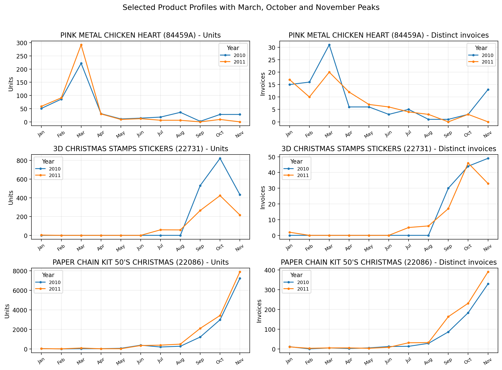
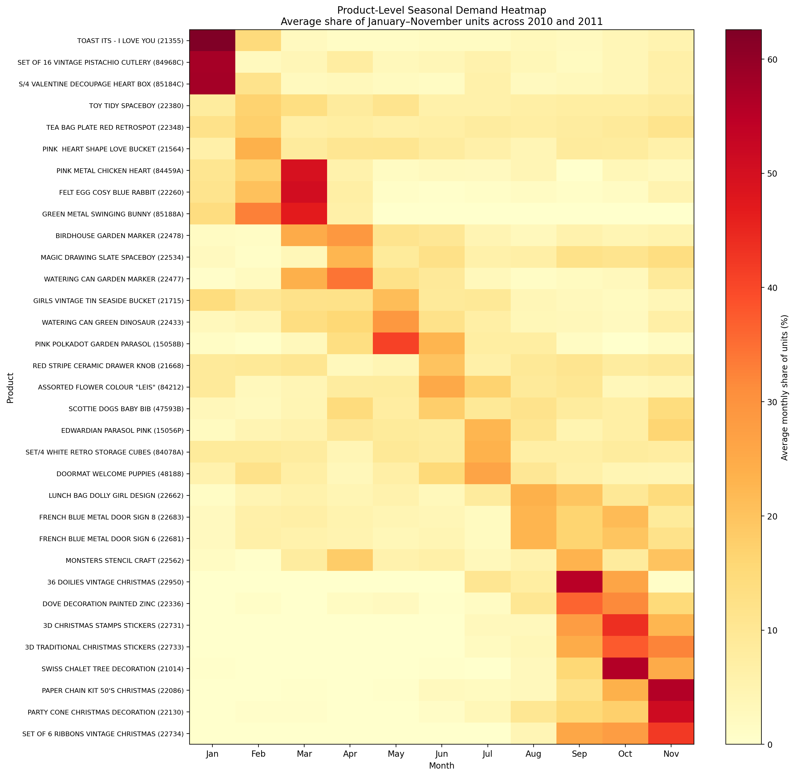

# Seasonal Product Demand Analysis

A reproducible Python data-analysis project that investigates recurring monthly product-demand peaks in the **UCI Online Retail II** transaction dataset. The workflow is designed for a course-end EDAV project and a public portfolio repository.

[](https://colab.research.google.com/github/sharonmedithi0304/seasonal-product-demand-analysis/blob/main/notebooks/Seasonal_Product_Demand_Analysis.ipynb)

## Project at a glance

- **Dataset:** UCI Online Retail II, covering transactions recorded from 1 December 2009 to 9 December 2011.
- **Raw data:** 1,067,371 transaction rows in two workbook sheets.
- **Cleaned data:** 1,008,892 rows after the documented cleaning pipeline.
- **Primary comparison:** January–November 2010 against January–November 2011. December is excluded because the recorded December periods are incomplete.
- **Result:** 292 exploratory recurring-peak candidates from 2,358 eligible products.
- **Most common candidate peak:** November, with 156 of 292 candidates (53.4%). October and November together account for 189 candidates (64.7%).

These are **exploratory candidates**, not statistically proven long-term seasonal products. The analysis compares only two annual windows and does not train or validate a forecasting model.

## Questions explored

1. **Monthly demand statistics:** How do monthly unit totals vary across the comparable periods?
2. **Quantity and revenue patterns:** How do monthly demand and recorded revenue compare year over year?
3. **Data cleaning and validation:** Which data-quality issues could distort product-demand analysis, and how are they handled?
4. **Product-level recurring peaks:** Which products peak in the same month in both years, and how strong is the repeated peak?
5. **Sensitivity and practical interpretation:** How does the candidate list change when peak-strength and invoice-support thresholds change?

## Method

1. Load both sheets of the UCI workbook and combine them.
2. Audit data types, missing values, duplicate rows, cancellation-coded invoices, non-positive quantities, and price anomalies.
3. Remove exact duplicates, cancellation-coded invoices, non-positive quantities, negative prices, and rows with missing descriptions. Retain missing customer IDs because customer-level analysis is not required; zero-price records are also retained.
4. Create year/month fields, revenue, and carefully normalized product keys. Original stock codes remain available for traceability.
5. Aggregate quantity and distinct invoice activity by product, year, and month for January–November 2010 and 2011.
6. Screen products for at least 10 distinct invoices per year, a repeated peak month, a peak-to-average monthly quantity ratio of at least 1.5 in both years, and at least 10 distinct invoices during the peak month in each year.
7. Validate the final watchlist and export supporting tables and figures.

The peak index is a screening metric: the peak month's unit quantity divided by the product's mean monthly quantity in the comparison window. The correlation measure is used as supporting profile similarity, not as proof of causation or seasonality.

## Key results

| Measure | Result |
|---|---:|
| Eligible products | 2,358 |
| Candidates before peak-month invoice support at the 1.5 threshold | 426 |
| Final recurring-peak candidates | 292 |
| November peak candidates | 156 (53.4%) |
| October + November candidates | 189 (64.7%) |
| Candidate count at peak-index thresholds 1.25 / 1.5 / 2.0, after invoice support | 301 / 292 / 224 |
| Candidate count with 0 / 10 / 20 minimum peak invoices per year | 426 / 292 / 215 |

### Selected examples

The representative figure deliberately shows three readable examples with different repeated peak months. The full 292-product watchlist is retained in the output tables.

| Product | Repeated peak | Peak index (2010) | Peak index (2011) | Peak invoices (2010 / 2011) |
|---|---|---:|---:|---:|
| PINK METAL CHICKEN HEART | March | 4.63 | 6.25 | 31 / 20 |
| 3D CHRISTMAS STAMPS STICKERS | October | 5.06 | 4.55 | 44 / 46 |
| PAPER CHAIN KIT 50'S CHRISTMAS | November | 6.42 | 5.88 | 329 / 390 |

## Selected figures

### Monthly demand: year-over-year



### Quantity and revenue heatmaps



### Distribution of repeated peak months



### Product-level demand profiles



### Product/month heatmap



## Run the project

### Option A — Google Colab

1. Open the notebook through the **Open in Google Colab** badge above after the repository is published under `sharonmedithi0304/seasonal-product-demand-analysis`.
2. Run the notebook from the first cell.
3. The notebook downloads the UCI workbook automatically, creates the figures, validates the watchlist, and exports `outputs/EDAV_Final_Outputs.zip`.
4. In Colab, the final cell also triggers a ZIP download.

### Option B — Local Jupyter (Windows, macOS, or Linux)

```bash
git clone https://github.com/sharonmedithi0304/seasonal-product-demand-analysis.git
cd seasonal-product-demand-analysis
python -m venv .venv
```

Activate the environment, then install dependencies:

**Windows Command Prompt**

```bat
.venv\Scripts\activate
python -m pip install -r requirements.txt
jupyter lab
```

**macOS / Linux**

```bash
source .venv/bin/activate
python -m pip install -r requirements.txt
jupyter lab
```

Open `notebooks/Seasonal_Product_Demand_Analysis.ipynb` and run it from the first cell. The raw workbook is downloaded into `data/raw/` and is intentionally excluded from Git tracking. The analysis outputs are written to `outputs/`.

## Repository structure

```text
seasonal-product-demand-analysis/
├── README.md
├── requirements.txt
├── .gitignore
├── data/
│   ├── README.md
│   └── raw/                       # downloaded at runtime; not committed
├── notebooks/
│   └── Seasonal_Product_Demand_Analysis.ipynb
└── outputs/
    ├── figures/                   # selected notebook-generated figures
    └── tables/                    # validated CSV results and methodology notes
```

## Output files

The `outputs/tables/` folder contains the full seasonal candidate watchlist, top-20 subset, cleaning and missing-value audits, monthly demand summary, peak-month distribution, sensitivity analyses, representative-product data, product/month share matrix, and methodology/limitations notes. The `outputs/figures/` folder contains the corresponding charts.

## Limitations and responsible interpretation

- Only two comparable January–November windows are analyzed; recurrence across two years is limited evidence.
- A repeated peak may reflect product naming, promotions, one-off events, or catalog changes rather than a stable underlying seasonal mechanism.
- Invoice counts measure transaction activity, not unique customers.
- The cleaning pipeline removes cancellation-coded invoices and non-positive quantities; results describe retained positive-quantity transactions rather than net sales after returns.
- The analysis does not estimate forecast accuracy and does not measure impacts on stockouts, waste, profit, or inventory cost.

## Dataset citation

Chen, D. (2012). *Online Retail II* [Dataset]. UCI Machine Learning Repository. https://doi.org/10.24432/C5CG6D

Dataset landing page: https://archive.ics.uci.edu/dataset/502/online+retail+ii

The dataset is distributed under CC BY 4.0 according to UCI; retain attribution to the original source when reusing the data. See `data/README.md` for details.

## Author

**Sharon Medithi**  
B.Tech Information Technology · 2025–2029
